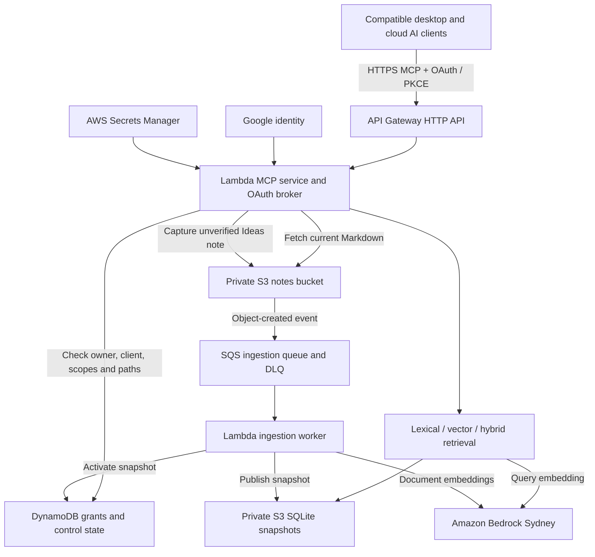
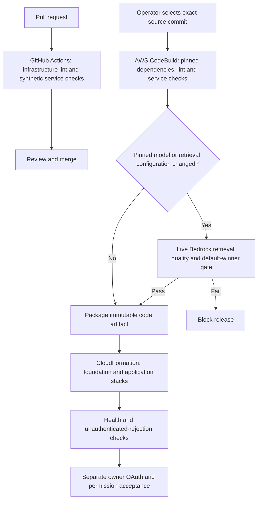

# Personal Knowledge Base

> The value of a knowledge base = knowledge density × retrieval frequency ×
> depth of verification

A personal knowledge service for making experience compound across AI tools.
Assistants retrieve relevant context about the owner's experience, decisions and
ways of working, then capture useful new learning for later retrieval.

The project started with an Obsidian Markdown vault and a local MCP server.
Its second generation adds an authenticated cloud MCP service on AWS, so access
no longer depends on the original computer running or a client reaching the
home network. The local service remains available.

**This public repository contains tooling, infrastructure, specifications and
synthetic fixtures. Private notes, embeddings, credentials and owner-specific
evaluation cases stay outside Git.**

[Project case study and Miro diagrams](https://www.midu.com.au/work/personal-knowledge-base/)

## Current status

Deployment snapshot: **20 October 2026**, development environment in AWS Sydney
(`ap-southeast-2`).

- The cloud MCP, private S3 note storage and full hybrid index are deployed. The
  service exposes search, fetch, raw learning capture, change-status and
  access-status tools.
- Google OAuth establishes identity. The backend separately enforces
  owner/client grants, scopes, path restrictions, expiry and revocation.
- Desktop OAuth registration and sign-in have succeeded after adding the
  loopback callback to the allowlist. Each client still needs its own KB grant;
  a successful sign-in does not prove private-note or write access.
- The connected Google-authenticated MCP client has passed a live capture,
  exact-revision fetch, idempotent retry, scope denial and background-indexing
  proof. Lexical and hybrid searches retrieve the saved synthetic note.
- The raw API Gateway endpoint is available. The certificate for
  `mcp.midu.com.au` is issued, but the custom hostname is **not live**.
  The deployment permission blocker was resolved and live domain/mapping
  creation verified on 20 October 2026; DNS and OAuth activation remain in
  [UPS-58](https://jin-family.atlassian.net/browse/UPS-58).
- Copying notes to S3 and activating an index do not establish a completed
  source-of-truth cutover. Offline-device, cross-client write/read, migration,
  recovery and operational acceptance work remains tracked in the
  [cloud feature tasks](specs/006-cloud-kb-mcp/tasks.md).

The deployed development release is pinned to
[`e0734e5`](https://github.com/SongGithub/personal-knowledge-base/commit/e0734e5088c0640dd03723b848d6c4e3459a8563),
including the deployment/retrieval fixes from PR #4 and capture recovery in
[PR #7](https://github.com/SongGithub/personal-knowledge-base/pull/7).
Some older acceptance records describe earlier releases; their dated results
are not a claim that every current acceptance task has passed.

## Architecture



Markdown is the source format. The cloud service reads and writes its private
S3 namespace; SQLite search indexes are derived, rebuildable data. Notes and
index snapshots use separate versioned buckets with public access blocked,
ACLs disabled, TLS required and SSE-S3 encryption at rest.

Document and query embeddings use **Cohere Embed Multilingual v3** through
Amazon Bedrock in Sydney. The contract pins the model, 1,024 dimensions,
normalisation and chunking. The local oMLX/bge-m3 index uses a different model
space and cannot be reused as the cloud vector index. The parity goal is useful
retrieval behaviour and bilingual quality, rather than identical rankings.

[Cloud specification](specs/006-cloud-kb-mcp/spec.md) ·
[Data model](specs/006-cloud-kb-mcp/data-model.md) ·
[Embedding model decision](specs/006-cloud-kb-mcp/model-decision.md)

## MCP tools and the learning loop

| Cloud tool | Purpose | Access boundary |
| --- | --- | --- |
| `search_kb` | Search with `lexical`, `vector` or the default `hybrid` strategy | `kb:read` and permitted note paths |
| `fetch_note` | Fetch current Markdown from S3 independently of indexing | `kb:read` and permitted note paths |
| `capture_learning` | Create a new raw Markdown learning with provenance and an operation ID | Separate `kb:capture` grant for an exact raw-capture destination |
| `update_note` | Replace one exact passage in an existing ordinary note using `expected_revision` | Separate `kb:update` + read grant; protected knowledge requires review |
| `get_change_status` | Check persistence and indexing status for a capture operation | The authenticated owner/client that owns the operation |
| `get_access_status` | Show the caller's verified client ID, owner binding and grant state | Any authenticated client; reads no notes |

The learning loop is **retrieve → apply → capture → index → retrieve again**.
Capture writes a new note marked `unverified`; it does not approve or overwrite
canonical Wiki content. Identical operation retries are idempotent, and reusing
an operation ID with different content is rejected.

The local implementation accepts granted destinations under `Ideas/` or
`Resources/_Review/AI Learning/`. The latter matches the owner's approved
learning-review folder. A client must supply its exact granted prefix; support
for a folder does not grant access to it. The owner access page offers 90 days
or one year (365 days), defaulting to one year, with explicit renewal/revocation.

Persistence and indexing are separate outcomes. A saved note can be fetched
before it appears in search. S3 events queue background ingestion; the worker
chunks changed content, generates document embeddings and publishes a snapshot.
Use `get_change_status` to inspect the operation rather than assuming that a
successful write means indexing is complete.

`get_change_status` compares the capture's SHA-256 with the active snapshot:
`indexed` means the saved content is present, `pending` means it is absent,
`superseded` means the path has different indexed content, and `not_checked`
means the index could not be inspected. `operation_audit: recorded` refers to
the durable operation record. `activity_audit: pending` means the separate
vault activity-log append has not been confirmed. The local append component
uses conditional writes, verifies the saved log revision and recovers on an
identical capture retry. It is disabled by default and reports
`activity_audit_reason: not_enabled`; the create-only client grant does not
authorise editing that log.
Enabling it requires separate owner authorisation, exact-path IAM permission
and the operator-controlled `PKB_ACTIVITY_LOG_ENABLED=true` setting. Current
infrastructure grants no activity-log write permission.

The capture corrections are deployed and the live write/read/index loop passed.
See the [deployment proof](specs/006-cloud-kb-mcp/writeback-deployment-proof.md)
and [handoff](specs/006-cloud-kb-mcp/writeback-local-handoff.md) for the evidence
and remaining wider acceptance work.

The local MCP is read-only and exposes `search_kb` and `fetch_note`.

[Tool contracts](specs/006-cloud-kb-mcp/contracts/mcp-tools.md) ·
[Cloud API implementation](cloud_kb/api.py) ·
[Capture implementation](cloud_kb/writer.py)

## Connect an AI client

Existing development endpoint:

```text
https://hv015iren3.execute-api.ap-southeast-2.amazonaws.com/mcp
```

Use a client supporting remote HTTP MCP and OAuth. Google sign-in requests the
owner's user ID and email, without Drive or Gmail access. The MCP backend
requires a separately provisioned grant for that registered client.

For Codex, add the URL and start OAuth login:

```sh
codex mcp add personal_kb_cloud --url https://hv015iren3.execute-api.ap-southeast-2.amazonaws.com/mcp
codex mcp login personal_kb_cloud
```

An empty optional bearer-token field is valid for this OAuth setup. The desktop
callback allowlist includes `http://127.0.0.1/callback`; the pinned server library
allows its local port to vary while matching the host and path. Other clients
must use their own approved callbacks and complete OAuth onboarding. Do not
assume one desktop login verifies ChatGPT web or another client.

### Approve, renew or revoke access yourself

When a KB grant is missing, expired, revoked or lacks a scope, the tool error
includes an owner access link. `get_access_status` also returns
`access_management.url`, expiry and `renewal_required` (within 30 days of expiry).
Open that link, sign in with the configured Google owner account, check the
client ID/name/callback and choose **Approve / renew access**. Choose read-only
or read plus new learning notes, for 90 days or **one year (365 days)**. Retry
the original MCP operation after approval, retaining its operation ID. To edit
existing notes, choose **Read, create and update ordinary notes**; this adds
`kb:update` for Ideas, Projects, Areas, Resources, Personal Facts and Templates.
Fetch the cloud note's `revision`, then pass it unchanged as `expected_revision`
with an exact, unique `old_text` / `new_text` replacement. Other text is preserved.

The same page supports revocation and renewal, including after expiry. Existing
grants keep their current expiry until renewed. MCP tokens cannot approve
grants, and grants do not silently extend. Capture remains restricted to
`Resources/_Review/AI Learning/`. Updates are a separate explicit permission;
Wiki, policy/AGENTS notes, verified knowledge and source snapshots remain
protected, and no file deletion is enabled. See [ordinary note updates](specs/006-cloud-kb-mcp/note-updates.md).
This flow needs no AWS credentials or operator intervention.

The operator-only [`tools/grant_mcp_client.py`](tools/grant_mcp_client.py) remains
available for bounded recovery (up to 90 days). AI clients receive MCP
credentials rather than AWS credentials or machine access. See the
[self-service access design and delivery record](specs/006-cloud-kb-mcp/self-service-access.md).

Grants are bound to the OAuth **client ID**, not just the owner. A client that
registers again receives a new client ID and needs a new owner decision; an
existing grant never transfers based on a matching client name. Complete the
owner access page for the new ID. Call `get_access_status` to see the client ID, whether the signed-in account
is the owner and whether a live grant exists. Other `forbidden` reasons
(`owner_mismatch`, `grant_revoked`, `grant_expired`, `missing_scope`,
`malformed_grant`, `identity_unavailable`) are reported separately so the cause
is not confused with a token or consent problem.

For the local service, see the
[OpenClaw and local MCP connection guide](docs/openclaw-kb-connection.md).

## Retrieval evaluation

The cloud benchmark exercises the production embedding adapter, chunker and
retrieval code against the same synthetic corpus and query embeddings. It
compares lexical, pure vector and hybrid strategies; the expanded fixture has
20 synthetic notes and 33 judged queries covering paraphrases, similar notes
with different answers, exact IDs and English/Chinese cross-language retrieval.

Latest recorded live Bedrock results, 19 October 2026:

| Strategy | Expected note ranked first | Expected note in top three | Exact-ID top one | Cross-language top three |
| --- | --- | --- | --- | --- |
| Lexical | 22/33 | 26/33 | 7/7 | 1/6 |
| Pure vector | 28/33 | 33/33 | 6/7 | 6/6 |
| Hybrid | 29/33 | 33/33 | 7/7 | 6/6 |

Hybrid remains the cloud default on this evidence. This is an end-to-end
retrieval evaluation on a small synthetic fixture, not an isolated embedding
score, a generated-answer evaluation or a relevance measurement on private
notes. Owner-judged questions from regular use remain the next quality step.

To run the live synthetic gate with an authorised AWS session and the cloud
verification dependencies installed:

```sh
python3 tools/benchmark_cloud_embeddings.py --require-default-best
```

This command invokes Bedrock in Sydney and incurs inference usage. It sends
repository synthetic text, not the private KB.

[Benchmark implementation](tools/benchmark_cloud_embeddings.py) ·
[Synthetic fixture](tests/fixtures/cloud-kb/hybrid-benchmark.json) ·
[Recorded model comparison](specs/006-cloud-kb-mcp/model-decision.md)

## CI/CD and infrastructure as code



GitHub Actions provides credential-free PR validation. The current AWS delivery
path is an operator-triggered, on-demand CodeBuild project pinned to a source
commit. CodeBuild deploys with its AWS service role and a separate scoped
CloudFormation provisioning role. GitHub's OIDC deployment jobs remain inactive
in this account; a merge does not automatically release the cloud MCP.

The deployed pipeline requires the paid retrieval gate for model/retrieval
configuration changes. Other releases still run infrastructure and synthetic
service checks. Health `200` and an unauthenticated MCP `401` establish liveness
and rejection behaviour; they do not prove authenticated note access.

[Infrastructure overview](infra/README.md) ·
[Native pipeline runbook](infra/NATIVE-PIPELINE.md) ·
[Pipeline buildspec](infra/buildspec.yml) ·
[Deployment access](specs/006-cloud-kb-mcp/deployment-access.md)

## Local retrieval experiment

The first-generation CLI compares lexical, local oMLX vector and authority-aware
hybrid retrieval without changing the Obsidian vault. With the dependencies in
[`requirements.txt`](requirements.txt) installed and a local oMLX embedding
server running:

```sh
python3 retrieval_experiment.py index --model bge-m3-mlx-4bit
python3 retrieval_experiment.py benchmark --cases /path/outside/repo/private-cases.json --repeats 3
```

The vault is discovered in the current user's iCloud Obsidian container;
`--vault` overrides discovery. The disposable index and reports default to
`~/Library/Application Support/pkb-retrieval-experiment`; `--data-dir` must stay
outside both the vault and repository. `--authority` accepts a private note-path
map with `canonical`, `verified`, `ordinary`, `archive` or `unverified` tiers.
The local CLI accepts only a loopback embedding endpoint.

[Local experiment specification](specs/002-retrieval-quality-experiment/spec.md) ·
[Shared local retrieval specification](specs/003-shared-kb-retrieval/spec.md) ·
[Public synthetic case format](examples/synthetic-cases.json)

## Development and knowledge governance

SpecKit records the constitution, requirements, design, tasks and implementation
checks. Review changes against those artefacts, tool contracts, access boundaries
and evaluation evidence. Keep synthetic examples in this repository and private
content in the actual knowledge store.

The vault taxonomy remains `Ideas`, `Projects`, `Areas`, `Resources`, `Archive`,
`Wiki` and `Personal Facts`. Existing domain categories are entry notes within
that structure. Capture access does not authorise canonical synthesis, index
changes or folder migration; follow the vault's own review rules.

[Constitution](.specify/memory/constitution.md) ·
[Original wiki workflow](specs/001-personal-wiki-workflow/spec.md) ·
[Vault instruction template](templates/vault/AGENTS.md) ·
[Folder migration proposal](docs/vault-english-migration.md)
