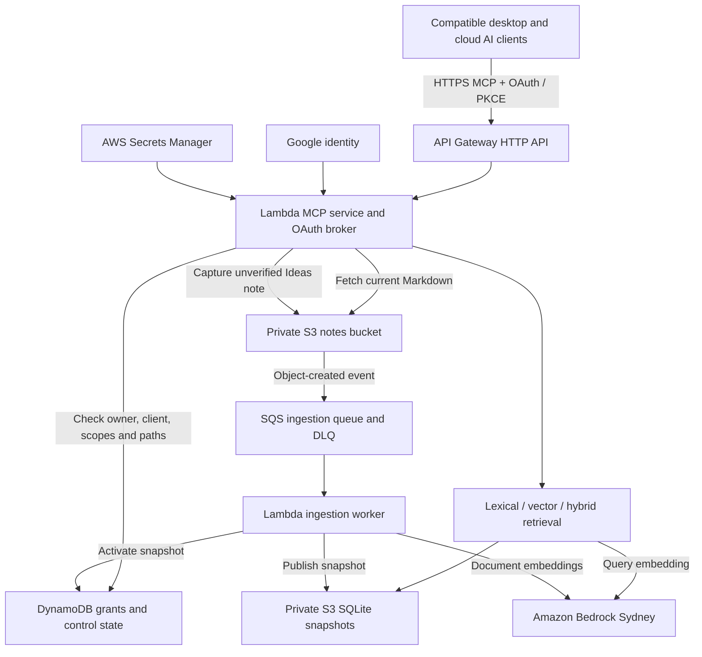
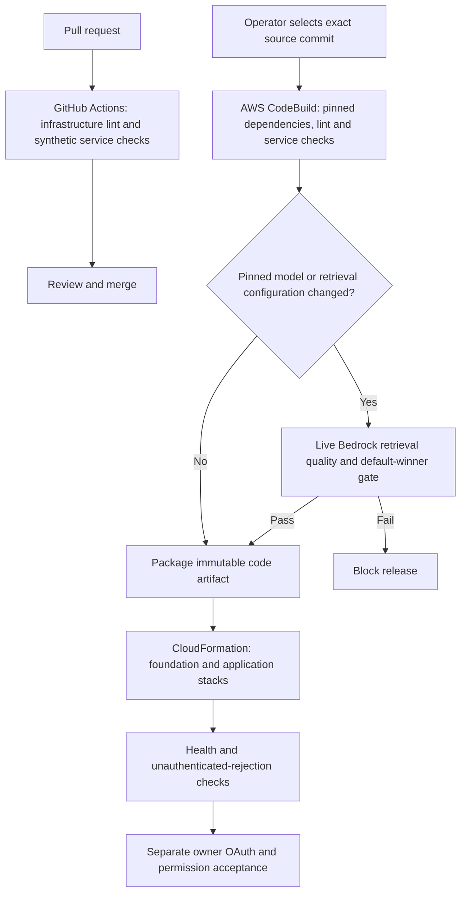

# Personal Knowledge Base

> Your knowledge stays with you when your AI changes.

A personal knowledge service designed to give Claude, ChatGPT and OpenClaw one
authoritative record of the owner's facts, decisions and lessons. MCP provides
a shared interface for retrieving evidence and capturing new learning, so
changing assistants requires less rebuilding of context.

The value is continuity across providers: maintain knowledge once, reuse it
through compatible clients, and keep control of the record as models and
subscriptions change. Each client surface still needs compatible MCP/OAuth
support, onboarding and its own access grant; naming a client here describes
the intended use, not completed acceptance on every surface.

The project started with an Obsidian Markdown vault and a local MCP server.
Its second generation adds an authenticated cloud MCP service on AWS, so access
no longer depends on the original computer running or a client reaching the
home network. The local service remains available.

**This public repository contains tooling, infrastructure, specifications and
synthetic fixtures. Private notes, embeddings, credentials and owner-specific
evaluation cases stay outside Git.**

[Project case study and Miro diagrams](https://www.midu.com.au/work/personal-knowledge-base/)

## Why a separate knowledge base?

Native assistant memory can remain useful alongside the KB. This project
provides an independent, inspectable record that authorised assistants can
share through MCP.

- **Less provider lock-in:** keep facts, decision rationale and lessons in
  portable Markdown when changing models or clients.
- **Less repeated briefing:** retrieve relevant context from the same record
  instead of maintaining a separate version in each assistant.
- **A record the owner controls:** retain sources and dates, distinguish
  proposed learning from approved knowledge, and review canonical changes.

Canonical means the designated, owner-approved record; it does not mean every
claim is infallible. MCP abstracts access, while client instructions and the
review workflow establish authority. Assistants should consult relevant KB
evidence and surface conflicts with their own recollections for resolution.

## How experience compounds

The operating model is **retrieve → apply → observe → capture → review →
reuse**. Experience compounds when a reviewed lesson changes later work and
its outcome is checked. Saving notes or generating embeddings alone does not
demonstrate that improvement.

1. Retrieve relevant past decisions, evidence and lessons before starting.
2. Apply them to the task and record the actual outcome, including failures.
3. Have AI propose a short learning: context, action, result, supporting
   evidence, where it may apply and what remains uncertain.
4. Review proposals in small batches. The owner approves changes to canonical
   facts, preferences and reusable methods; AI-written captures stay unverified.
5. Reuse an approved lesson in a later task, link the outcome back to it, and
   revise or retire it when the evidence changes.

For example, a hypothetical deployment failure might suggest a preflight
check. AI can link the incident evidence and draft that check; the owner reviews
its scope before adoption. A later deployment tests whether the check helped.
The next assistant can retrieve that reviewed lesson without repeating the
original investigation.

AI can assist with retrieval, capture, duplicate detection, synthesis and
review preparation. Human oversight decides what becomes authoritative and
whether a proposed generalisation is justified. This is the intended workflow;
the current service provides retrieval and bounded write primitives, rather
than an autonomous system that verifies and promotes lessons.

Measure compounding through later reuse, corrections, repeated mistakes and
time to a usable result. The synthetic retrieval benchmark below measures
ranking quality, not experience compounding or productivity gains.

Working principle: **knowledge density × retrieval frequency × depth of
verification**.

## Current status

Deployment snapshot: **19 October 2026**, development environment in AWS Sydney
(`ap-southeast-2`).

- The cloud MCP, private S3 note copy and full hybrid index are deployed. The
  service exposes search, fetch, raw learning capture and change-status tools.
- Google OAuth establishes identity. The backend separately enforces
  owner/client grants, scopes, path restrictions, expiry and revocation.
- Desktop OAuth registration and sign-in have succeeded after adding the
  loopback callback to the allowlist. Each client still needs its own KB grant;
  a successful sign-in does not prove private-note or write access.
- The raw API Gateway endpoint is available. The certificate for
  `mcp.midu.com.au` is issued, but the custom hostname is **not live**: API
  Gateway custom-domain creation awaits an AWS organisation permission change.
- Copying notes to S3 and activating an index do not establish a completed
  source-of-truth cutover. Offline-device, cross-client write/read, migration,
  recovery and operational acceptance work remains tracked in the
  [cloud feature tasks](specs/006-cloud-kb-mcp/tasks.md).

The deployed development release is pinned to
[`4a3e114`](https://github.com/SongGithub/personal-knowledge-base/commit/4a3e114e9c291fa2dc52e0ac47ba7f9794a43ec4),
including deployment and conditional evaluation changes tracked in
[PR #4](https://github.com/SongGithub/personal-knowledge-base/pull/4).
Some older acceptance records describe earlier releases; their dated results
are not a claim that every current acceptance task has passed.

## Architecture



Markdown is the source format. The cloud service reads and writes its private
S3 namespace; SQLite search indexes are derived, rebuildable data. Notes and
index snapshots use separate versioned buckets with public access blocked,
ACLs disabled, TLS required and SSE-S3 encryption at rest.

Document and query embeddings use **Cohere Embed Multilingual v3** through
Amazon Bedrock in Sydney. The contract pins the model, 1,024 dimensions,
normalisation and chunking. The local oMLX/bge-m3 index uses a different model
space and cannot be reused as the cloud vector index. The parity goal is useful
retrieval behaviour and bilingual quality, rather than identical rankings.

[Cloud specification](specs/006-cloud-kb-mcp/spec.md) ·
[Data model](specs/006-cloud-kb-mcp/data-model.md) ·
[Embedding model decision](specs/006-cloud-kb-mcp/model-decision.md)

## MCP tools and the learning loop

| Cloud tool | Purpose | Access boundary |
| --- | --- | --- |
| `search_kb` | Search with `lexical`, `vector` or the default `hybrid` strategy | `kb:read` and permitted note paths |
| `fetch_note` | Fetch current Markdown from S3 independently of indexing | `kb:read` and permitted note paths |
| `capture_learning` | Create a new raw Markdown learning with provenance and an operation ID | Separate `kb:capture` grant for a specific `Ideas/` destination |
| `get_change_status` | Check persistence and indexing status for a capture operation | The authenticated owner/client that owns the operation |

The learning loop is **retrieve → apply → capture → index → retrieve again**.
Capture writes a new note marked `unverified`; it does not approve or overwrite
canonical Wiki content. Identical operation retries are idempotent, and reusing
an operation ID with different content is rejected.

Persistence and indexing are separate outcomes. A saved note can be fetched
before it appears in search. S3 events queue background ingestion; the worker
chunks changed content, generates document embeddings and publishes a snapshot.
Use `get_change_status` to inspect the operation rather than assuming that a
successful write means indexing is complete.

The local MCP is read-only and exposes `search_kb` and `fetch_note`.

[Tool contracts](specs/006-cloud-kb-mcp/contracts/mcp-tools.md) ·
[Cloud API implementation](cloud_kb/api.py) ·
[Capture implementation](cloud_kb/writer.py)

## Connect an AI client

Existing development endpoint:

```text
https://hv015iren3.execute-api.ap-southeast-2.amazonaws.com/mcp
```

Use a client supporting remote HTTP MCP and OAuth. Google sign-in requests the
owner's user ID and email, without Drive or Gmail access. The MCP backend
requires a separately provisioned grant for that registered client.

For Codex, add the URL and start OAuth login:

```sh
codex mcp add personal_kb_cloud --url https://hv015iren3.execute-api.ap-southeast-2.amazonaws.com/mcp
codex mcp login personal_kb_cloud
```

An empty optional bearer-token field is valid for this OAuth setup. The desktop
callback allowlist includes `http://127.0.0.1/callback`; the pinned server library
allows its local port to vary while matching the host and path. Other clients
must use their own approved callbacks and complete OAuth onboarding. Do not
assume one desktop login verifies ChatGPT web or another client.

The owner can provision bounded read/capture grants with
[`tools/grant_mcp_client.py`](tools/grant_mcp_client.py), using an authorised AWS
operator session and the verified owner/client identity. AI clients receive MCP
credentials rather than AWS credentials or machine access.

For the local service, see the
[OpenClaw and local MCP connection guide](docs/openclaw-kb-connection.md).

## Retrieval evaluation

The cloud benchmark exercises the production embedding adapter, chunker and
retrieval code against the same synthetic corpus and query embeddings. It
compares lexical, pure vector and hybrid strategies; the expanded fixture has
20 synthetic notes and 33 judged queries covering paraphrases, similar notes
with different answers, exact IDs and English/Chinese cross-language retrieval.

Latest recorded live Bedrock results, 19 October 2026:

| Strategy | Expected note ranked first | Expected note in top three | Exact-ID top one | Cross-language top three |
| --- | --- | --- | --- | --- |
| Lexical | 22/33 | 26/33 | 7/7 | 1/6 |
| Pure vector | 28/33 | 33/33 | 6/7 | 6/6 |
| Hybrid | 29/33 | 33/33 | 7/7 | 6/6 |

Hybrid remains the cloud default on this evidence. This is an end-to-end
retrieval evaluation on a small synthetic fixture, not an isolated embedding
score, a generated-answer evaluation or a relevance measurement on private
notes. Owner-judged questions from regular use remain the next quality step.

To run the live synthetic gate with an authorised AWS session and the cloud
verification dependencies installed:

```sh
python3 tools/benchmark_cloud_embeddings.py --require-default-best
```

This command invokes Bedrock in Sydney and incurs inference usage. It sends
repository synthetic text, not the private KB.

[Benchmark implementation](tools/benchmark_cloud_embeddings.py) ·
[Synthetic fixture](tests/fixtures/cloud-kb/hybrid-benchmark.json) ·
[Recorded model comparison](specs/006-cloud-kb-mcp/model-decision.md)

## CI/CD and infrastructure as code



GitHub Actions provides credential-free PR validation. The current AWS delivery
path is an operator-triggered, on-demand CodeBuild project pinned to a source
commit. CodeBuild deploys with its AWS service role and a separate scoped
CloudFormation provisioning role. GitHub's OIDC deployment jobs remain inactive
in this account; a merge does not automatically release the cloud MCP.

The deployed pipeline requires the paid retrieval gate for model/retrieval
configuration changes. Other releases still run infrastructure and synthetic
service checks. Health `200` and an unauthenticated MCP `401` establish liveness
and rejection behaviour; they do not prove authenticated note access.

[Infrastructure overview](infra/README.md) ·
[Native pipeline runbook](infra/NATIVE-PIPELINE.md) ·
[Pipeline buildspec](infra/buildspec.yml) ·
[Deployment access](specs/006-cloud-kb-mcp/deployment-access.md)

## Local retrieval experiment

The first-generation CLI compares lexical, local oMLX vector and authority-aware
hybrid retrieval without changing the Obsidian vault. With the dependencies in
[`requirements.txt`](requirements.txt) installed and a local oMLX embedding
server running:

```sh
python3 retrieval_experiment.py index --model bge-m3-mlx-4bit
python3 retrieval_experiment.py benchmark --cases /path/outside/repo/private-cases.json --repeats 3
```

The vault is discovered in the current user's iCloud Obsidian container;
`--vault` overrides discovery. The disposable index and reports default to
`~/Library/Application Support/pkb-retrieval-experiment`; `--data-dir` must stay
outside both the vault and repository. `--authority` accepts a private note-path
map with `canonical`, `verified`, `ordinary`, `archive` or `unverified` tiers.
The local CLI accepts only a loopback embedding endpoint.

[Local experiment specification](specs/002-retrieval-quality-experiment/spec.md) ·
[Shared local retrieval specification](specs/003-shared-kb-retrieval/spec.md) ·
[Public synthetic case format](examples/synthetic-cases.json)

## Development and knowledge governance

SpecKit records the constitution, requirements, design, tasks and implementation
checks. Review changes against those artefacts, tool contracts, access boundaries
and evaluation evidence. Keep synthetic examples in this repository and private
content in the actual knowledge store.

The vault taxonomy remains `Ideas`, `Projects`, `Areas`, `Resources`, `Archive`,
`Wiki` and `Personal Facts`. Existing domain categories are entry notes within
that structure. Capture access does not authorise canonical synthesis, index
changes or folder migration; follow the vault's own review rules.

[Constitution](.specify/memory/constitution.md) ·
[Original wiki workflow](specs/001-personal-wiki-workflow/spec.md) ·
[Vault instruction template](templates/vault/AGENTS.md) ·
[Folder migration proposal](docs/vault-english-migration.md)
